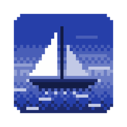

<p align="center">
  
</p>

<h1 align="center">t3boat</h1>

<p align="center">
  Run your <a href="https://t3.codes">T3 Code</a> agents in the cloud, on your own <a href="https://boat.dev">Boat</a> subscription.<br>
  Machines sleep when idle, so you only pay for the minutes your agents run.
</p>

---

t3boat is a small menu bar app. It creates cloud machines, adds them to T3 Code as remote environments, and puts them to sleep when no agent is working. Send a message to a sleeping machine's chat and it wakes in seconds. To T3 Code on your computer, every machine always looks online.

## Why

- **Pay for agent time, not idle time.** A machine sleeps once no agent has run for a few minutes, and a sleeping machine costs nothing.
- **Running work finishes with your laptop closed.** The machine decides when to sleep, so it finishes its work first. Sending a message or waking a machine goes through t3boat on your computer, so that needs your laptop on.
- **Browse while asleep.** Chats, the project list and anything you looked at before are served from your computer, so opening a chat doesn't wake the machine.
- **Nothing to configure.** Uses the Boat CLI's login, Boat's GitHub auth for private repos, and T3 Code's own pairing and project flows.

## Features

- Create, resize and delete machines from the menu bar (small, default, large)
- Add a project to a machine, the same way T3 Code's "Add to another machine" does, `.env` files included
- Sign Claude Code or Codex in on a machine with their own login; your laptop's credentials are never copied
- Turn on T3 Connect for a machine to reach it from T3 Code on your phone or in a browser; webhooks sent while it sleeps run when it wakes
- Keep a machine awake for a while, or until you stop it
- Automations and other scheduled T3 work wake a sleeping machine in time, while t3boat runs
- Cost today and this month, per machine and in total. The totals keep counting a machine deleted within that period
- Machines show up as linked environments in T3 Code, so local agents can hand them work (`delegate_task`, `t3_thread_launch`)
- An MCP server so Claude Code and Codex on your computer can manage machines themselves
- T3 server version on each machine follows your desktop app, upgraded on wake

## Requirements

- macOS, Windows or Linux. On a Linux desktop without a system tray (GNOME without the AppIndicator extension), t3boat opens as a normal window; closing it keeps t3boat running, and launching it again brings the window back.
- [T3 Code](https://t3.codes) desktop app
- [Boat](https://boat.dev) CLI, signed in

t3boat walks you through installing and signing in to Boat if it's missing.

## Install

There's no prebuilt download yet; build it from source. You need [Rust](https://rustup.rs) and [Bun](https://bun.sh), on Windows the [Microsoft C++ Build Tools](https://v2.tauri.app/start/prerequisites/#windows), and on Linux [Tauri's system packages](https://v2.tauri.app/start/prerequisites/#linux) (on Debian and Ubuntu: `sudo apt install libwebkit2gtk-4.1-dev libayatana-appindicator3-dev librsvg2-dev libxdo-dev libssl-dev build-essential file`).

```sh
git clone https://github.com/paukraft/t3boat && cd t3boat
bun install
bun run build:desktop
```

The app lands in `apps/desktop/src-tauri/target/release/bundle/`. On macOS, copy `macos/t3boat.app` to `/Applications` and open it. It lives in the menu bar. On Linux, install `deb/t3boat_*.deb` and start t3boat from your app launcher, or run the AppImage in `appimage/`. It lives in the system tray; click it and choose "Open t3boat". On Windows, run `nsis/t3boat_*-setup.exe`. t3boat lives in the system tray, possibly behind the tray's overflow arrow.

Or have your coding agent do it:

```
Please build and install t3boat (https://github.com/paukraft/t3boat) on my computer: clone it, follow the Install section of its README, and open the app when it's done.
```

## Usage

1. Click the boat in the menu bar and create a machine. Pick projects to put on it if you like.
2. T3 Code asks to add the new backend. Accept.
3. If a coding agent on the machine needs a sign-in, click its button in t3boat and authorize in the browser.
4. Work in T3 Code as usual. The machine wakes when you use it and sleeps when its agents are done.

Changes go back the way they do in T3 Code: push or open a PR from the machine.

### Agents on your computer

In t3boat's settings, click "Add" for Claude Code or Codex to register t3boat as an MCP server there. They get tools to list, create, wake, sleep, resize and delete machines, add projects and sign agents in.

With linked environments on in T3 Code (Settings → Labs), every machine is also linked into T3 Code, so local agents can start threads and delegate tasks on it.

## How it works

```
T3 Code ──ws──> localhost proxy (t3boat) ──https/wss──> T3 server on a Boat sandbox
                    │                                     └─ watchdog: stops the sandbox when idle
                    └─ boat CLI: new / resume / host / exec / delete
```

- Each machine is a Boat sandbox running the T3 server, pinned to your desktop app's version.
- T3 Code connects to a proxy on `localhost`, one per machine, so a new sandbox address after waking never matters.
- While a machine sleeps, the proxy answers from the state it captured as the machine went to sleep. Anything that needs the real machine wakes it.
- A watchdog on the machine stops it after 5 minutes with no agent run, no build and nothing from you. It saves a snapshot first, so the machine survives even if Boat drops the stopped disk.

Full details: [apps/desktop/docs/architecture.md](apps/desktop/docs/architecture.md).

## Development

Bun workspace monorepo.

```sh
bun install
bun run dev                          # website
bun run dev:desktop                  # menu bar app
cd apps/desktop/src-tauri && cargo run --bin t3boat-dev   # headless; commands on stdin: list | create <name> [size] | wake | sleep | keep [minutes] | connect | pair | delete | upgrade | costs
```

- `apps/desktop`: the menu bar app (Tauri, Rust + React)
  - `src-tauri/src/boat.rs`: Boat CLI wrapper (uses the CLI's own login)
  - `src-tauri/src/machine/`: machine runtime (power, wake, watchdog, capture, projects, agent sign-in) and provisioning scripts
  - `src-tauri/src/proxy/`: localhost proxy (HTTP, auth, WebSocket session, cache, RPC classification, media streams, linked environments)
  - `src-tauri/src/projects.rs`: T3 projects from a shell snapshot, and the rules of T3's "Add to another machine"
  - `src-tauri/src/t3desktop.rs`: the T3 Code desktop app (version, deep links, linked environments, its server's API)
  - `src-tauri/src/mcp.rs`: MCP server for local coding agents
  - `src-tauri/src/app.rs`: app model; `tray.rs`: tray and commands
  - `src/`: popover UI (runs on `src/mock.ts` outside Tauri); `src/brand.css`: fonts and colors, shared with the site
  - `docs/`: [architecture](apps/desktop/docs/architecture.md), [T3 protocol notes](apps/desktop/docs/t3-protocol.md), [UI ↔ backend contract](apps/desktop/docs/ui-contract.md)
- `apps/web`: the website. Its demo plays T3 Code on the popover's mock backend (`src/Together.tsx`)
  - `demo.html`: the popover UI on that backend
  - `public/t3code`: a mock of T3 Code's window, built from T3 Code's own source

## License

[MIT](LICENSE)

---

Made by [Pau Kraft](https://x.com/paukraft). Not affiliated with or endorsed by T3 Code or Boat.
